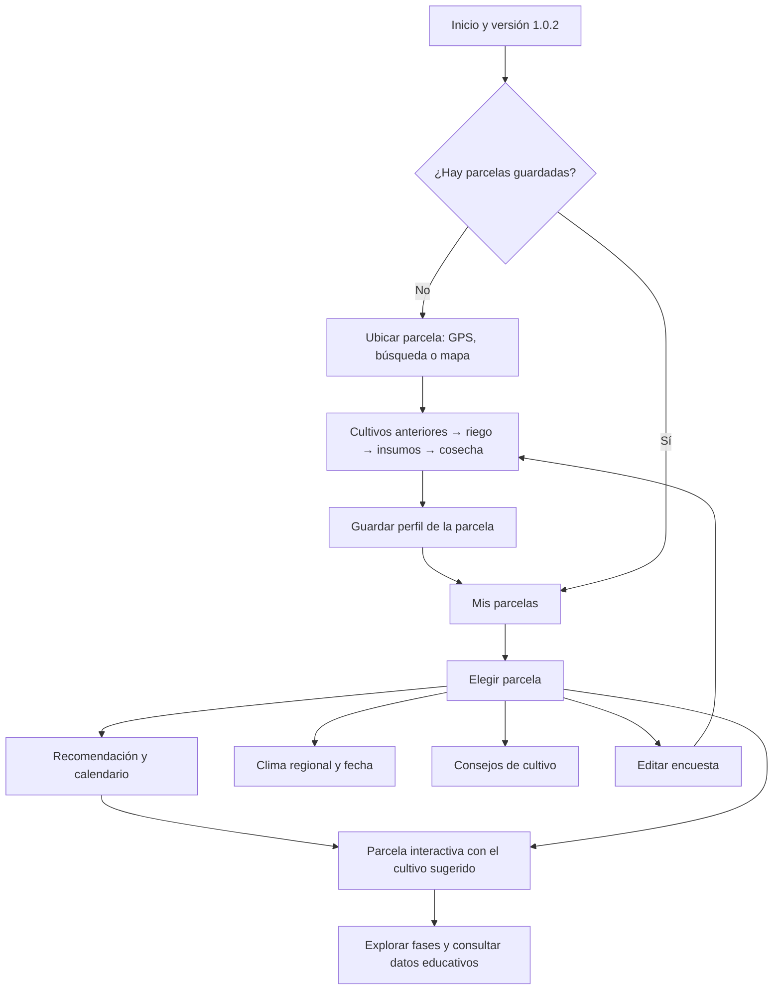
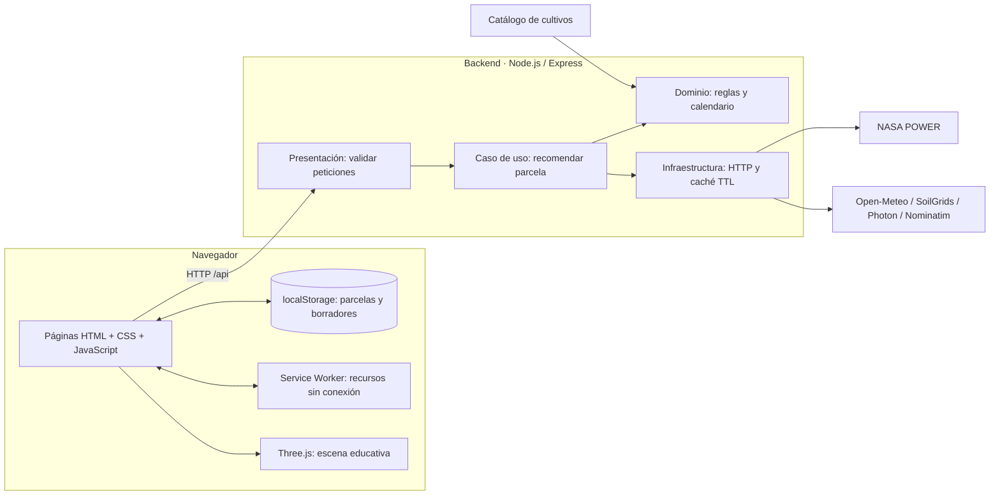

# Musuq Allpa

**Asistente agrícola web · versión 1.0.2**

Musuq Allpa ayuda a un agricultor a registrar sus parcelas, responder una encuesta breve y explorar qué cultivos se ajustan a las condiciones de su terreno. Combina las respuestas con un catálogo agronómico y datos regionales de NASA POWER para ofrecer recomendaciones explicables y un calendario de cultivo.

**Aplicación publicada:** [musuq.cholotec.dev](https://musuq.cholotec.dev)

## 1. Qué puede evaluar el jurado

| Capacidad | Comportamiento observable |
| --- | --- |
| Registro de parcelas | GPS, búsqueda de localidad o selección directa en el mapa. Permite guardar aunque los datos de altitud o suelo estén temporalmente indisponibles. |
| Encuesta guiada | Cultivos anteriores, riego, insumos y meses deseados de cosecha; permite volver y conservar respuestas. |
| Recomendaciones explicables | Cultivos sugeridos, criterios revisados, restricciones, rotación y calendario. |
| Clima regional | Resumen de temperatura, lluvia, viento y humedad superficial, con fecha de los datos. |
| Parcela interactiva | Cubo inmersivo por defecto, cultivo planificado separado de la campaña anterior, condiciones regionales NASA, riego representado y avance guardado por parcela. |
| Diseño móvil | Letras grandes, una pantalla a la vez y avance vertical con rueda o gesto. Una mano animada enseña a deslizar; se conservan los botones de la encuesta. |
| Acceso e inclusión | Selector de español, quechua e inglés, navegación por teclado, foco visible, lectura por voz cuando el navegador la admite y movimiento reducido. |
| Continuidad sin conexión | Consulta de información y recursos previamente almacenados después de una primera visita con internet. |
| Neugrac | Consejos por parcela en carrusel y radio espacial original: mantener 3 segundos para encender/apagar, lanzar para cambiar de música. |

El motor de recomendación es **determinista y basado en reglas**, no un modelo generativo. Neugrac es la guía visual de la experiencia. TikTok y el bloque Otras herramientas están conservados en `archive/otras-herramientas/` y no se publican.

## 2. Recorrido de evaluación

No se requiere una cuenta. Para comprobar el flujo desde cero, usar una ventana privada o un navegador sin parcelas guardadas.

1. **Registrar una parcela.** Buscar una localidad peruana o permitir el GPS. Revisar la posición del pin en el mapa y confirmar el terreno. Se consultan altitud y datos regionales complementarios.
2. **Completar la encuesta.** Indicar los cultivos de la campaña anterior, cómo se riega, qué insumos se utilizan y en qué meses se desea cosechar. El retroceso conserva el borrador.
3. **Consultar “¿Qué siembro?”.** Revisar la propuesta, los criterios y el calendario. El acceso “Explorar este cultivo en mi parcela” abre el cultivo recomendado en la vista interactiva.
4. **Explorar la campaña.** Usar Anterior, Siguiente, reproducción o arrastre para recorrer las fases. Cambiar entre Espacio y Campo y abrir Ver datos para consultar los indicadores educativos.
5. **Comprobar la integración.** Abrir Datos de mi encuesta, editar respuestas o cambiar de parcela. La encuesta, el cultivo explorado y el avance pertenecen a la parcela correspondiente.
6. **Consultar el clima.** Revisar la fecha y los detalles del resumen regional. No interpretar esa fecha como una medición en tiempo real del terreno.
7. **Verificar móvil y persistencia.** Repetir con un ancho de 320–430 px, cambiar de idioma y recargar la página. Después de la primera carga, probar sin conexión los recursos almacenados.

**Ejemplo de demostración:** una parcela en la sierra de Junín, con cultivo anterior de papa, riego por lluvia y guano. Los resultados dependen de los datos disponibles y del catálogo; no se promete un cultivo ganador fijo.

## 3. Flujo del usuario



## 4. Arquitectura

La aplicación es un **monolito Node.js con frontend estático**. Express sirve las páginas y la API bajo el mismo origen. La separación interna distingue presentación, aplicación, dominio e infraestructura.



### Responsabilidades

| Capa | Ubicación | Responsabilidad |
| --- | --- | --- |
| Interfaz | `*.html`, `css/`, `js/ui/` | Pantallas, navegación, idioma, accesibilidad y composición responsive. |
| Estado local | `js/almacen.js`, `js/ruta.js` | Parcelas, parcela activa, borradores y continuidad del registro. |
| Vista interactiva | `js/features/interactive/` | Adaptar la encuesta a la escena y controlar fases, gráficos e interacción 3D. |
| Presentación HTTP | `server/app.js`, `server/presentation/` | Rutas, validación, CORS y respuestas de error. |
| Aplicación | `server/application/` | Coordinar perfil, catálogo y proveedores para obtener una recomendación. |
| Dominio compartido | `shared/domain/` | Reglas agronómicas, calendario y resumen climático sin dependencia de Express o del DOM. |
| Infraestructura | `server/infrastructure/` | Consultas externas, normalización, timeout y caché acotada. |
| Catálogos | `data/` | Cultivos, traducciones y series de simulación. |
| Verificación y entrega | `tests/`, `tools/build.cjs`, `Dockerfile`, `deployment.yaml` | Pruebas, build reproducible e infraestructura de publicación. |

El dominio compartido permite usar el mismo motor en el servidor y en la evaluación local sin conexión. Los proveedores se inyectan en el caso de uso, lo que permite probar la API y las reglas con datos externos controlados.

### Cómo se genera una recomendación

1. El navegador envía la ubicación y el perfil de la parcela a `POST /api/recommendations`.
2. La API valida coordenadas, estructura y respuestas.
3. El caso de uso consulta el clima NASA y traduce las respuestas a las entradas del motor.
4. El motor evalúa el catálogo según las condiciones disponibles: altitud, clima, suelo, pendiente, rotación, riego, insumos y meses de cosecha.
5. La respuesta incluye propuestas, criterios, restricciones y advertencias. La interfaz presenta los resultados y enlaza el cultivo sugerido con la parcela interactiva.

Las consultas repetidas comparten una caché en memoria de hasta 500 entradas, con caducidad de una hora y deduplicación de peticiones simultáneas. Cada consulta externa tiene un timeout de 12 segundos. Los fallos no se guardan en esa caché.

## 5. Datos, persistencia y límites

| Información | Origen | Interpretación |
| --- | --- | --- |
| Ubicación y respuestas | GPS, selección en mapa y encuesta | Información confirmada o declarada por el usuario. |
| Altitud | Open-Meteo; respaldo de zona cuando existe | Estimación geográfica, no levantamiento topográfico. |
| Suelo y pendiente | SoilGrids y estimación con elevaciones | Estimaciones regionales, no análisis de laboratorio. |
| Clima | NASA POWER | Serie diaria regional con retraso; se muestra su fecha. |
| Reglas y calendario | `data/cultivos.json`, dominio compartido | Modelo orientativo y explicable. |
| NDVI, humedad, lluvia y temperatura de la escena | `data/interactive.json` | **Simulación educativa**, no mediciones del terreno ni una campaña real. |

Las parcelas y los borradores se guardan en **localStorage del navegador**. No hay cuentas, base de datos central ni sincronización entre dispositivos. El backend recibe el perfil para calcular la recomendación y no lo almacena como un registro persistente. Borrar los datos del navegador elimina las parcelas guardadas.

El service worker conserva los recursos incluidos en su lista de precarga. El registro inicial, las nuevas consultas geográficas, las teselas del mapa y la actualización del clima necesitan internet. Leaflet y Three.js se distribuyen localmente; las fuentes externas tienen alternativas del sistema.

Si NASA no responde, la recomendación puede continuar con criterios incompletos y `NASA_NO_DISPONIBLE`. Los datos desconocidos no se presentan como mediciones. El clima almacenado de otra parcela no se reutiliza como si perteneciera a la parcela activa.

La herramienta orienta la planificación; no sustituye una evaluación agronómica presencial. El catálogo y las traducciones requieren revisión con especialistas y hablantes locales antes de ampliar su alcance. `data/zonas.json` está vacío: no se ofrece una cobertura geográfica propia basada en ese archivo.

## 6. Ejecutar el proyecto

**Requisitos:** Node.js 22 LTS o superior y npm. Se recomienda conexión a internet para el registro y las consultas externas.

```sh
npm ci
npm start
```

Abrir [http://localhost:3000](http://localhost:3000). Para desarrollo con recarga del servidor:

```sh
npm run dev
```

Se debe usar Express, no únicamente un servidor de archivos estáticos: la aplicación necesita las rutas `/api`.

### Configuración

Ver `.env.example`. Las variables se inyectan desde el entorno o mediante `node --env-file=.env server/index.js`.

| Variable | Valor por defecto | Uso |
| --- | --- | --- |
| `HOST` | `0.0.0.0` | Interfaz de escucha. |
| `PORT` | `3000` | Puerto HTTP. |
| `CORS_ORIGINS` | `https://musuq.cholotec.dev,http://localhost:3000` | Orígenes permitidos, separados por comas. |
| `NODE_ENV` | Según el entorno | `production` en despliegue. |
| `GOOGLE_MAPS_API_KEY` | Sin configurar | Activa Google Maps y Places (New) en el registro. Sin clave se conserva OpenStreetMap con Leaflet. |

Google Maps requiere una clave de navegador de Google Cloud con Maps JavaScript API y Places API (New) habilitadas y facturación activa. Restringirla a `https://musuq.cholotec.dev/*` y a los orígenes locales usados en desarrollo. Se configura en el servidor; no se guarda en el repositorio. Kubernetes lee `api-key` del Secret opcional `musuq-google-maps`. No se requiere un client ID de OAuth. El mapa usa vista satelital con etiquetas, pin central y zoom accesible; el buscador usa sesiones de Autocomplete y solicita únicamente la ubicación al seleccionar un resultado.

Las consultas geográficas se solicitan en inglés. La interfaz, los cultivos, las fechas y los avisos se adaptan mediante el catálogo español/inglés/quechua; los nombres propios y valores del agricultor se conservan. Las páginas antiguas de ubicación y siembra dirigen al registro vigente.

Fuera de localhost, la geolocalización requiere HTTPS. Si el frontend se sirve desde otro origen, se puede definir `window.CAMPO_API_BASE` antes de cargar `js/core/api.js`.

## 7. Pruebas y evidencia

```sh
npm test
npx playwright install chromium
npm run test:e2e
npm run build
```

| Verificación | Cobertura |
| --- | --- |
| Dominio | Escenarios agrícolas de sierra y costa, restricciones y selección de cultivos. |
| Integración HTTP | Validación, CORS, normalización de proveedores, caché y fallo de NASA. |
| Playwright | Registro completo, recomendaciones, clima, edición, navegación, idiomas, aislamiento por parcela, modo sin conexión y fallback sin 3D. |
| Responsive | Anchos móviles y de tableta, alineación de controles, separación de paneles, objetivos táctiles y ausencia de desbordamiento de página. |
| Build | Sintaxis JavaScript, scripts de páginas, JSON y referencias a archivos locales. |

Las pruebas E2E locales sustituyen únicamente los adaptadores de proveedores por datos deterministas. La API, la validación y el motor siguen siendo los de la aplicación. Las pruebas de GPS cubren permiso denegado, recuperación al habilitarlo y posición aproximada; la web no puede cambiar los permisos del dispositivo. Chromium emula escritorio y móvil; esa emulación no equivale a una prueba en un teléfono físico.

**Evidencia generada:** `playwright-report/index.html`, `test-results/report.json`, capturas y trazas en `test-results/`. Para ejecutar solo móvil: `npm run test:mobile`. Si se utiliza un Chromium ya instalado, se puede indicar su ruta con `PLAYWRIGHT_CHROMIUM_EXECUTABLE_PATH`.

Comprobación del sitio publicado:

```sh
BASE_URL=https://musuq.cholotec.dev npm run test:e2e
```

El recorrido que depende de los proveedores de prueba se omite en el dominio público. Los datos de prueba de las demás comprobaciones se guardan en el navegador de Playwright.

## 8. Build y despliegue de la versión 1.0.2

`npm run build` genera `dist/` y `dist/release.json`, con versión, fecha y SHA-256 del contenido. Docker ejecuta el mismo build en una etapa Node 22 y entrega el resultado con dependencias de producción y usuario sin privilegios.

El despliegue actual usa Kubernetes, namespace `default`, Deployment `musuq-allpha` y Service `musuq-allpha-service`, con NodePort `32123`. El dominio público se enruta hacia ese servicio desde la infraestructura existente.

```sh
sudo nerdctl --namespace k8s.io build -t musuq-allpha:musuq-v1.0.2-20261116 .
kubectl apply -f deployment.yaml
kubectl rollout status deployment/musuq-allpha --timeout=120s
curl https://musuq.cholotec.dev/api/health
```

La respuesta de salud identifica `version: "1.0.2"`. El manifiesto actual usa una imagen local y `imagePullPolicy: Never`; en otro clúster se debe distribuir la imagen a los nodos o configurar un registro y la política de descarga correspondiente. La publicación no cambia la ubicación de los datos del agricultor: siguen en su navegador.

## 9. Referencia de API

| Método | Ruta | Función |
| --- | --- | --- |
| GET | `/api/health` | Salud del proceso y versión. |
| GET | `/api/maps-config` | Proveedor de mapas y clave pública restringida de navegador, cuando está configurada. |
| GET | `/api/climate?lat=...&lon=...` | Serie climática regional normalizada. |
| GET | `/api/elevation?lat=...&lon=...` | Elevación. |
| GET | `/api/soil?lat=...&lon=...` | Propiedades regionales del suelo. |
| GET | `/api/slope?lat=...&lon=...` | Pendiente estimada. |
| GET | `/api/reverse?lat=...&lon=...` | Nombre de la ubicación. |
| GET | `/api/search?q=...` | Búsqueda de localidades mediante Photon. |
| GET | `/api/search?q=...&provider=nominatim` | Proveedor alternativo de búsqueda. |
| POST | `/api/recommendations` | Evaluación de la parcela y propuestas de cultivo. |

## 10. Tecnologías y créditos

Node.js, Express 5, JavaScript, HTML, CSS, Leaflet 1.9.4, Three.js r128, Playwright y `node:test`. Datos externos de NASA POWER, Open-Meteo, SoilGrids, Photon, Nominatim y OpenStreetMap. Las licencias de las bibliotecas distribuidas se conservan en `js/vendor/`.

## Experiencia inmersiva y pendientes

La vista interactiva abre en modo inmersivo dentro de la ventana; el botón de pantalla completa solicita el modo nativo después de un toque, cuando el navegador lo admite. Opciones permite cambiar de parcela o cultivo, revisar la encuesta y abrir los datos. El plan se guarda en `parcela.plan.cultivo`; no reemplaza los cultivos de la campaña anterior.

La temperatura, lluvia, humedad superficial y viento proceden del último día disponible de NASA POWER para las coordenadas de esa parcela. El viento anima las plantas y la humedad afecta al aspecto del suelo. El crecimiento futuro, NDVI y calendario visual son una simulación educativa. Si NASA falla, se muestran el estado y la fecha disponibles; no se usan datos de otra parcela.

La radio genera cuatro composiciones ambientales originales con Web Audio. Empieza apagada, se controla mediante una pulsación de 3 segundos sobre Neugrac y cambia al lanzarlo. También admite mantener Espacio o Intro al enfocarlo con teclado. No necesita servicios de música externos.

Logos y favicon: ver `docs/assets.md`. Pendiente de activar la API key de Google Maps: ver `TODO.md`.
